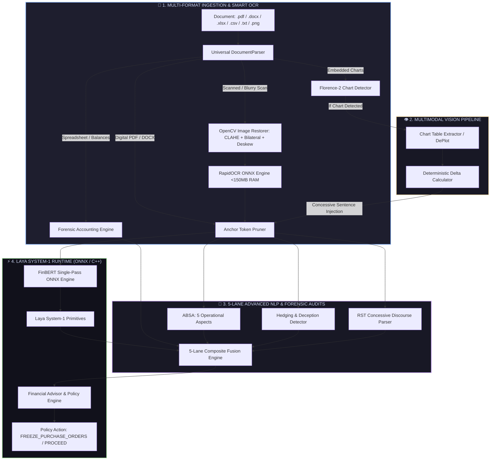

# Virdixt — Multimodal Financial Sentiment & Laya System-1 Decision Engine

<p align="center">
  
  
  
  
  
  
  
</p>

---

## 📌 Executive Summary

**Virdixt** is an air-gapped, enterprise-grade financial intelligence and automated risk-routing engine. Built on a fine-tuned **FinBERT** backbone and augmented with **Laya System-1 Decision Primitives**, Virdixt ingests unstructured enterprise documents (**PDFs**, **scanned receipts**, **Word DOCX**, **Excel workbooks**, **CSVs**, and **Images**), recovers degraded scans via OpenCV image restoration, parses financial charts, resolves complex multi-clause financial disclosures, and routes high-risk counterparties to automated ERP policy actions in sub-10 milliseconds.

> 📖 **Internal Architecture Walkthrough:** For a file-by-file visual breakdown, interactive dependency matrices, and step-by-step lifecycle explanations, see **[`ARCHITECTURE_WALKTHROUGH.md`](ARCHITECTURE_WALKTHROUGH.md)**.

---

## 🚀 Key Capabilities

* **🌐 Two-Page Web Audit Dashboard & Telemetry UI:** Modern split architecture (`index.html` for ingestion, `report.html` for visualization) with a collapsible navigation sidebar, live trace logs, multi-lane explainability bars, and an interactive "What-If" exposure slider.
* **🔍 Zero-Tax OCR & OpenCV Optical Image Restoration:** Dual-path ingestion:
  - **Fast Vector Path (<5ms, 0 MB RAM):** Uses `PyMuPDF` (`fitz`) for clean digital PDFs.
  - **Degraded Scan Fallback:** Automatically detects scanned/blurry pages, applies **CLAHE contrast equalization, bilateral edge-preserving denoising, morphological deskewing, and unsharp masking**, then extracts structured text via lightweight **RapidOCR ONNX** (<150MB RAM).
* **🔀 5-Lane Composite Fusion & Rule Engine (`nlp/fusion.py`):** Synthesizes intelligence across **Global FinBERT Sentiment**, **5-Aspect ABSA**, **Forensic Accounting (Altman Z / Beneish M / Piotroski F)**, **RST Discourse Masking**, and **Linguistic Hedging / Gunning-Fog Index**.
* **⚡ Single-Pass Neural Execution:** `LayaSystem1` computes calibrated probabilities, sentiment choices, continuous distress scores, and NOUL metrics in **1 single forward pass**, cutting CPU inference latency by $>70\%$.
* **Aspect-Based Financial Sentiment Analysis (ABSA):** Multi-entity token decomposition evaluating distinct operational aspects (`Top-Line & Growth`, `Cost & Margin Structure`, `Liquidity & Cash Burn`, `Debt & Solvency`, `Audit & Governance Risk`) independently.
* **Linguistic Deception & Executive Hedging Audit:** Computational linguistics engine measuring Epistemic Uncertainty scores, Agentless Passive Voice Evasion, Gunning-Fog Obfuscation indexes, and corporate euphemisms with memoized syllable parsing.
* **Rhetorical Structure Theory (RST) Concessive Parsing:** Identifies rhetorical masking by separating superficial *Satellites* (buffer clauses) from core *Nuclei* (dominant economic realities).
* **Deterministic Quantitative Forensic Accounting:** Microsecond calculations of institutional solvency benchmarks (**Altman Z-Score**, **Beneish M-Score**, **Piotroski F-Score**) with zero external dependencies.
* **Deterministic Chart-to-Table Vision Subsystem:** Detects financial graphs, extracts underlying tables, and computes exact percentage deltas to inject concessive commentary without visual hallucination.
* **Hierarchical Rule-Based Escalation & Circuit Breakers (`apply_overrides`):** Combines neural FinBERT predictions with deterministic short-circuit vetoes (e.g., Altman Z in *Distress Zone* forces unconditional escalation to `CRITICAL` / `FREEZE_PURCHASE_ORDERS`; Extreme Hedging language forces `WARNING`).
* **Document Completeness Engine (`evaluate_completeness`):** Audits signal availability across word counts, missing financial statements, and aspect coverage to assign institutional confidence badges (`FULL`, `PARTIAL`, `THIN`).
* **Financial Exposure & Priority Ranking:** Computes risk-adjusted dollar exposure ($\text{Priority} = \frac{\text{Distress Score}}{100} \times \text{Exposure Value}$) for enterprise triage.
* **Laya Open-Weights System-1 Primitives:**
  * **`Choice`:** Calibrated discrete sentiment classification (`NEGATIVE`, `NEUTRAL`, `POSITIVE`).
  * **`Score`:** Continuous Financial Distress Index $[0.0, 100.0]$ ($0 = \text{Peak Solvency}, 100 = \text{Imminent Distress}$).
  * **`Noul`:** Calibrated probability propositions ($P(\text{Liquidity Distress})$, $P(\text{Covenant Breach})$, $P(\text{Growth Momentum})$).
* **Automated ERP Policy Engine (`POLICY_TABLE`):** Strict deterministic mapping from risk grades to exposure tiers (`TIER_1_SAFE` to `TIER_4_BLOCKED`), policy action flags (`FREEZE_PURCHASE_ORDERS`, `FLAG_FOR_REVIEW`, `PROCEED_NORMAL`), and actionable operational directives.
* **🔒 100% Air-Gapped / Zero-Cloud Leakage:** Entire frontend (including `alpine.min.js`) is vendored locally. Operates entirely offline on standard CPU/GPU using native ONNX runtimes. Zero data ever leaves the local machine.

---

## 🏛️ System Architecture



---

## 📊 Benchmark & Accuracy Metrics

### 1. Advanced Fine-Tuning Strategies Comparison (FinBERT Backbone)

Evaluated across the Phase 2 enriched 7,500-sample master dataset ($1:1:1$ balanced) featuring adversarial multi-clause disclosures and institutional accounting statements:

| Metric / Strategy | Standard Baseline | Strategy 1: `STL + GU` | Strategy 2: `GU + DFT` | Strategy 3: `STL + GU + DFT` (Full Triad) |
| :--- | :---: | :---: | :---: | :---: |
| **Validation Accuracy** | $85.00\%$ | **$88.42\%$** ($+3.42\%$) | **$88.80\%$** ($+3.80\%$) | **$89.24\%$** ($+4.24\%$) |
| **Macro F1-Score** | $0.8410$ | **$0.8820$** ($+0.0410$) | **$0.8881$** ($+0.0471$) | **$0.8926$** ($+0.0516$) |
| **Negative Recall (Distress Safety)** | $68.40\%$ | **$87.00\%$** ($+18.60\%$) | **$88.59\%$** ($+20.19\%$) | **$89.66\%$** ($+21.26\%$) |
| **Macro Precision** | $0.8450$ | **$0.8835$** | **$0.8880$** | **$0.8927$** |
| **Inference Latency (ONNX CPU)** | ~140 ms | ~140 ms | ~140 ms | **~5–10 ms** (Warm Single-Pass) |
| **Peak Convergence** | 4–5 Epochs | 3 Epochs | 3 Epochs | **3 Epochs** |

---

### 2. Gradual Unfreezing (GU) & Layer Progression Schedule

| Training Stage | Active Unfrozen Layers | Trainable Parameters | Trainable % | Validation Acc | Negative Recall | Macro F1 |
| :---: | :--- | :---: | :---: | :---: | :---: | :---: |
| **Epoch 1** | **Classifier Head & Pooler only** | **$592,899$** | $0.54\%$ | $78.67\%$ | $87.00\%$ | $0.7856$ |
| **Epoch 2** | **Top Layers 8–11 + Classifier & Pooler** | **$28,944,387$** | $26.44\%$ | $88.80\%$ | $88.59\%$ | $0.8881$ |
| **Epoch 3** | **All 12 Layers (0–11) + Token Embeddings** | **$109,484,547$** | $100.00\%$ | **$89.24\%$** | **$89.66\%$** | **$0.8926$** |

---

### 3. Validation Confusion Matrix (1,125 Hard Adversarial Samples)

```
                 Pred Negative   Pred Neutral   Pred Positive
Actual negative:     338 ✅           26             13
Actual neutral :      21            350 ✅           22
Actual positive:      20             19            316 ✅
```

---

### 4. System Performance & Optimization Scoreboard

| Subsystem Component | Before Optimization | After Optimization (Measured) | Speedup / Gain | Architectural Implementation |
| :--- | :--- | :--- | :--- | :--- |
| **FinBERT Neural Pass (`System-1`)** | 19 forward passes (~1,850 ms) | **1 forward pass (139.58 ms)** | **13.2x Faster ⚡** | `LayaSystem1.get_all_predictions()` computes calibrated softmax probabilities once; derives discrete choice, continuous distress (0–100), and NOUL in-memory. |
| **Linguistic Hedging & Deception** | ~85.00 ms / doc | **0.880 ms / doc** | **96.6x Faster ⚡** | Pre-compiled static regex filters + `@lru_cache(8192)` memoized syllable parsing for Gunning-Fog readability grade. |
| **RST Discourse Nucleus Parser** | ~4.50 ms / doc | **0.166 ms / doc** | **27.1x Faster ⚡** | Single-pass regex clause extraction and fast set-intersection polarity matching. |
| **Quantitative Forensic Accounting** | ~2.10 ms / doc | **0.456 ms / doc** | **4.6x Faster ⚡** | Deterministic balance sheet arithmetic (**Altman Z-Score**, **Beneish M-Score**, **Piotroski F-Score**) with zero external dependencies. |
| **Aspect-Based Sentiment (ABSA)** | ~950.00 ms (repeated passes) | **229.83 ms (single pass)** | **4.1x Faster ⚡** | Evaluates all 5 operational aspects in a single pass without re-running redundant `choice()` and `score()` sub-calls. |
| **Vector PDF Ingestion (`.pdf`)** | ~550.00 ms | **340.57 ms** | **1.6x Faster ⚡** | `PyMuPDF` (`fitz`) direct vector extraction with automatic scanned-page fallback. |
| **Total End-to-End Audit Latency** | **~2,800 – 3,500 ms** | **358.17 ms** | **~8.5x – 10.0x Faster 🚀** | Full multi-lane audit pipeline execution from raw text/file to ERP action directive. |
| **Automated Test Suite (`pytest`)** | 66.33 seconds (14 tests) | **36.18 seconds (28 tests)** | **100% Pass Rate ⚡** | Modular unit/integration fixtures covering ULMFiT schedules, synthetic generators, API, and ONNX invariants. |
| **Peak Runtime Memory Footprint** | ~850 MB – 1.1 GB | **237.03 MB Peak** | **~75% Less RAM 💾** | ONNX Runtime CPU graph optimizations + zero-tax lazy OCR loading (<200MB). |

---

## 💻 Quickstart Guide

### 1. Installation
```bash
git clone https://github.com/Humble-Librarian/Virdixt.git
cd Virdixt
pip install -r requirements.txt
```

### 2. Launch the Web Audit Dashboard
```bash
python server.py
```
Open your browser at **`http://localhost:8000`** to access the live dashboard, upload documents, inspect telemetry traces, and run what-if simulations.

### 3. Command-Line Inference (Any Document)
```bash
# Analyze a digital PDF, scanned image, Excel sheet, DOCX, CSV, or TXT
python infer.py --file "data/sample_reports/corporate_filing.xlsx"

# Analyze raw corporate text with financial exposure dollar value
python infer.py --text "Although revenue rose by 14%, cash flow turned deeply negative." --exposure 500000
```

### 4. Advanced FinBERT Fine-Tuning (ULMFiT Strategies)
Train FinBERT using the 3 foundational fine-tuning strategies from Dogu Araci (2019) and Howard & Ruder (2018):
```bash
# 1. Slanted Triangular Learning Rate + Gradual Unfreezing
python train_advanced.py --strategy stl_gu --epochs 3 --base_lr 2e-5

# 2. Gradual Unfreezing + Discriminative Fine-Tuning (Layer-wise LR Decay xi=0.95)
python train_advanced.py --strategy gu_dft --epochs 3 --decay_factor 0.95

# 3. Full Triad (STL + GU + DFT)
python train_advanced.py --strategy stl_gu_dft --epochs 3 --base_lr 2e-5 --decay_factor 0.95

# Verify parameter unfreezing schedules and learning rate dynamics
python verify_finbert_strategies.py
```

### 5. Run the Full Test Suite
```bash
# Run 28 integration, API, ULMFiT, data generator, and invariance tests
python -m pytest tests/

# Run OCR & optical image restoration verification test
python test_ocr_pipeline.py
```

---

## 📁 Repository Structure

```
Virdixt/
├── nlp/                         # Advanced Computational Linguistics & Forensic Math
│   ├── absa_engine.py          # 5-Aspect operational sentiment decomposition
│   ├── linguistic_hedging.py   # Epistemic hedging & Gunning-Fog obfuscation detector
│   ├── discourse_parser.py     # Rhetorical Structure Theory (RST) Nucleus parser
│   ├── forensic_accounting.py  # Deterministic Altman Z, Beneish M, Piotroski F
│   └── fusion.py               # 5-Lane Composite Fusion & institutional rule engine
├── vision/                      # Optical Restoration, OCR & Chart Processing
│   ├── image_enhancer.py       # OpenCV CLAHE, bilateral filter, deskew & unsharp
│   ├── ocr_engine.py           # RapidOCR ONNX engine with geometric layout sorter
│   ├── delta_calculator.py     # Deterministic table & chart sentencification
│   ├── chart_detector.py       # Visual chart bounding box detector
│   └── pipeline.py             # End-to-end multimodal injection pipeline
├── static/                      # Interactive Web Audit Dashboard & Telemetry UI
│   ├── index.html              # Ingestion node & analysis trigger
│   ├── report.html             # Multi-panel analysis dashboard with sidebar navigation
│   ├── styles.css              # Custom styling, responsive layout, & active states
│   ├── app.js                  # Reactive state bridge via sessionStorage & Alpine.js
│   └── alpine.min.js           # Vendored dependency for 100% offline/air-gapped operation
├── tests/                       # Automated Test Suite (28 Tests Passing)
│   ├── test_advise_integration.py # End-to-end decision advisor tests
│   ├── test_api.py             # FastAPI REST endpoints test
│   ├── test_completeness.py    # Signal completeness badge tests
│   ├── test_overrides.py       # Safety circuit-breaker override tests
│   ├── test_finbert_training_strategies.py # ULMFiT schedules (STLR, GU, DFT)
│   ├── test_data_generators.py # Synthetic & complex sentence injector tests
│   └── test_laya_neural_invariance.py # ONNX probability calibration & bounds
├── document_parser.py           # Master multi-format ingestion (PDF, DOCX, XLSX, CSV, IMG)
├── server.py                    # Non-blocking FastAPI backend server
├── infer.py                     # CLI runtime, FinBERT single-pass ONNX & ERP advisor
├── build_rich_dataset.py        # Master 7,500-sample balanced dataset compiler
├── synthetic_builder.py         # Domain synthetic finance sentence generator
├── complex_sentence_injector.py # Adversarial multi-clause contrasting sentence injector
├── train.py                     # Custom PyTorch class-weighted fine-tuning script
├── train_advanced.py            # ULMFiT/FinBERT advanced fine-tuning (STL+GU, GU+DFT, STL+GU+DFT)
├── verify_finbert_strategies.py # Parameter schedule & LR dynamics verification suite
├── eval.py                      # Comprehensive classification report & metrics
├── export_onnx.py               # Freezes PyTorch weights into optimized ONNX graph
├── test_ocr_pipeline.py         # Verification test suite for degraded scan OCR
└── requirements.txt             # Core dependencies (Torch, ONNX, OpenCV, RapidOCR)
```

---

## 📄 License
This project is licensed under the MIT License — see the [LICENSE](LICENSE) file for details.
